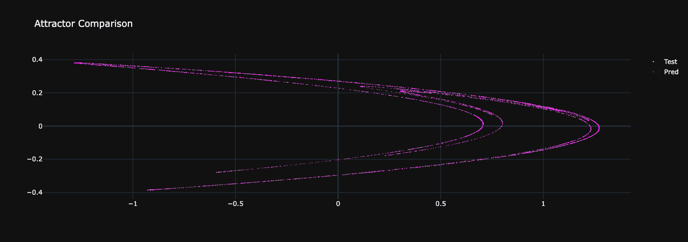
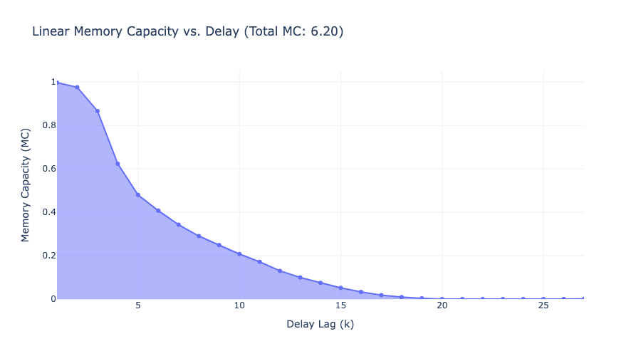
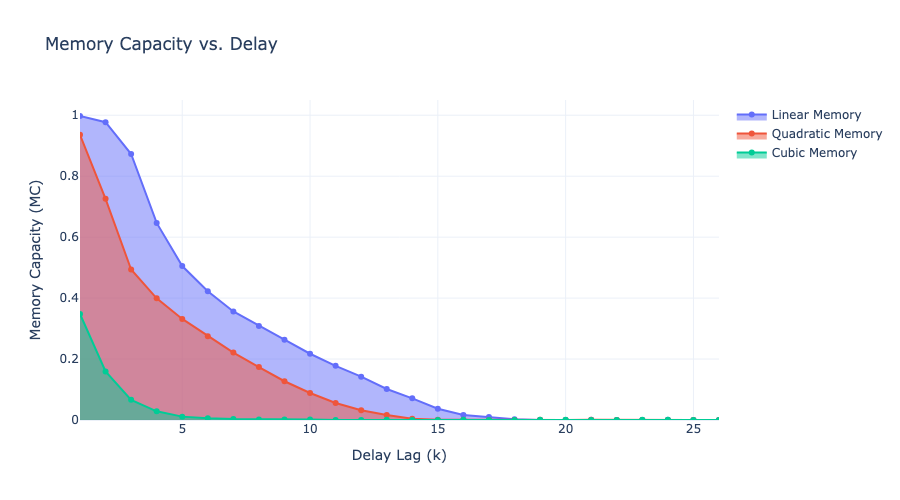
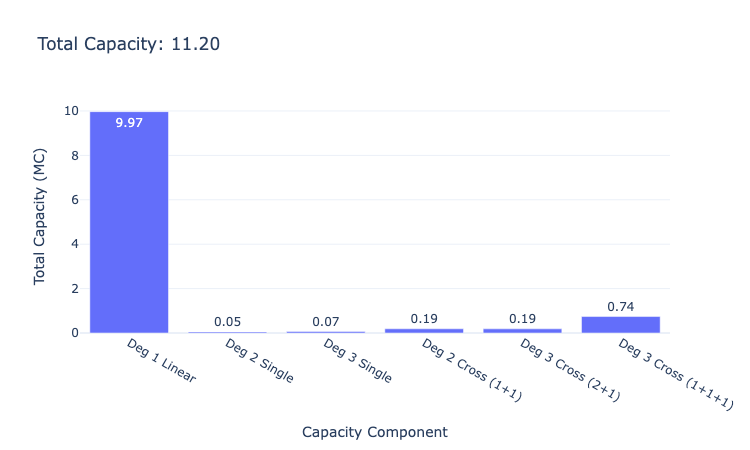

blah blah

	ss
					sss

addwadwadw

        bhjk

## `0_echo_state.ipynb`
- blah blah 
- **Plots:**
	- **0.1_henon_comparison.png**
	    
	    - blah blah
	    - **0.2_henon_r2.png**
	    
	    - blah blah
	    - **0.3_lin_mem_cap_vs_delay.png**
	    
	    - blah blah
	    - **0.4_gen_mem_cap_vs_delay.png**
	    
	    - blah blah
	    - **0.6_total_mem_cap_echo.png**
	    
	    - blah blah
	    - **0.7_d2_cross_mem_heatmap.png**
	    
	    - blah blah
	    - **0.8_d3_cross_mem_heatmap.png**
	    
	    - blah blah

## `1_compare_all.ipynb`
- blah blah 
- **Plots:**    - **1.1_total_mem_cap_echo.png**
    
    - blah blah
    - **1.2_total_mem_cap_spring.png**
    
    - blah blah
    - **1.3_total_mem_cap_spring_disorder.png**
    
    - blah blah
