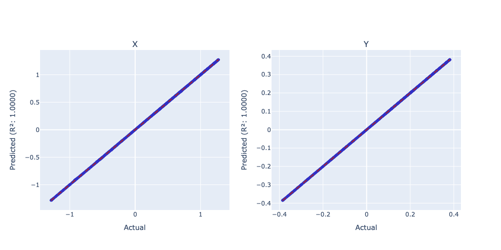
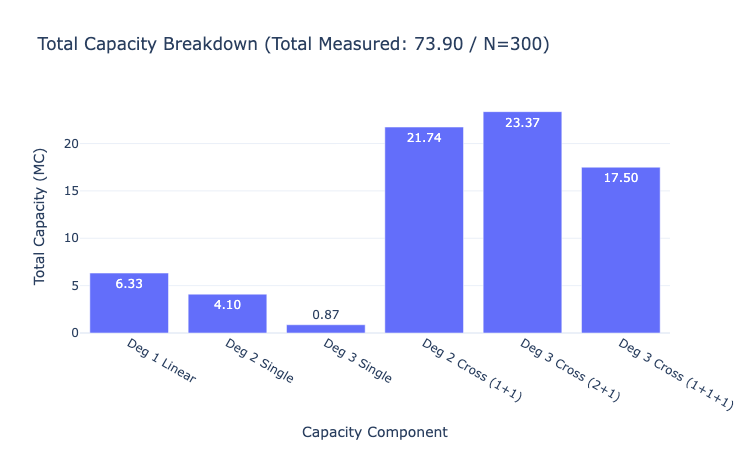
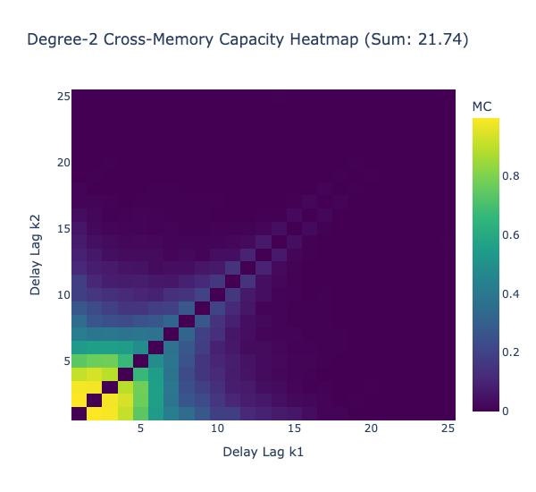
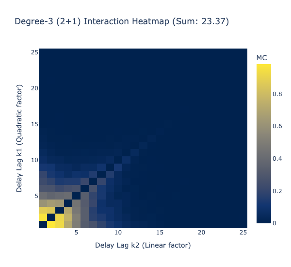
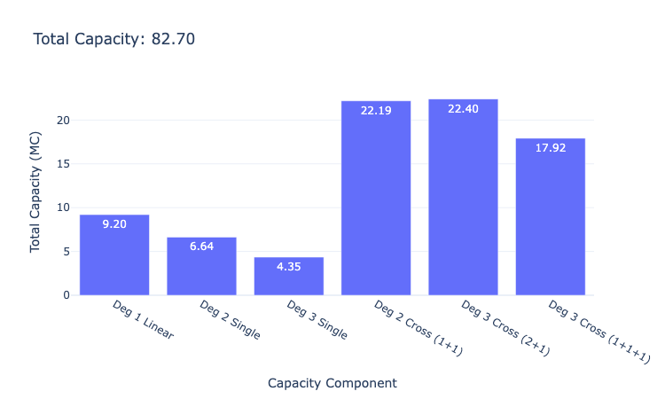
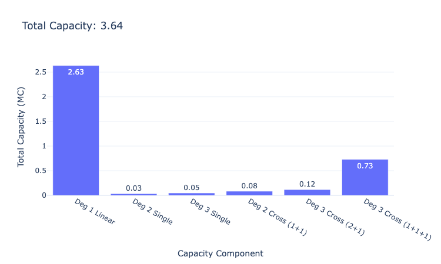

Look back on this but here I was reading [wringeReservoirComputingBenchmarks2024](../../../vault/literature/wringeReservoirComputingBenchmarks2024.md) and was using testing the linear and nonlinear capacity of reservoirs.

## `0_echo_state.ipynb`
- We test the echo states memory capacity across delays and also the capacity between non linear and linear memory
- **Plots:**
    - **0.1_henon_comparison.png**
        - Henon pred with echo state compared to actual
    - **0.2_henon_r2.png**
        - Henon pred with echo state r^2
    - **0.3_lin_mem_cap_vs_delay.png**
        - 0 to 1 per every K depending on how well correlation between prediction of k delay vs actual
    - **0.4_gen_mem_cap_vs_delay.png**
        - Same mem cap idea but pred k delay vs actual, pred k delay vs actual^2, pred k delay vs actual^3
    - **0.6_total_mem_cap_echo.png**
        - All mem cap with cross terms
    - **0.7_d2_cross_mem_heatmap.png**
        - Degree 2 all cross terms of every k delay till k=25
    - **0.8_d3_cross_mem_heatmap.png**
        - Degree 2 all cross terms of every k delay till k=25

## `1_compare_all.ipynb`
- Here we compare the memory cap between the echo state network, spring network, and a disorder spring network
- **Plots:**
    - **1.1_total_mem_cap_echo.png**
        - Total mem cap of echo state
    - **1.2_total_mem_cap_spring.png**
        - Total mem cap of spring
    - **1.3_total_mem_cap_spring_disorder.png**
        - Total mem cap of spring disorder
