## `0_simplified_all_mem_cap.ipynb`
- blah blah 
- **Plots:**

  - **0_all_point_disorder_spring_mem_cap.png.png**
    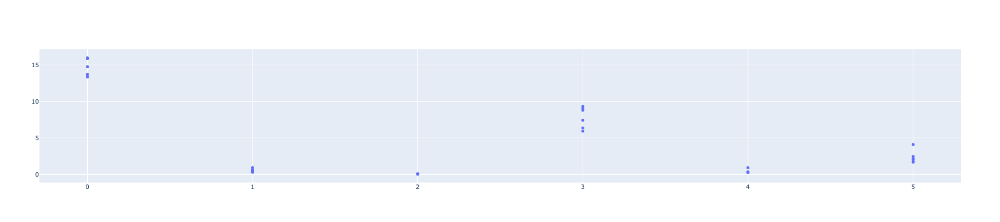
    - blah blah 

  - **0_all_point_order_spring_mem_cap.png.png**
    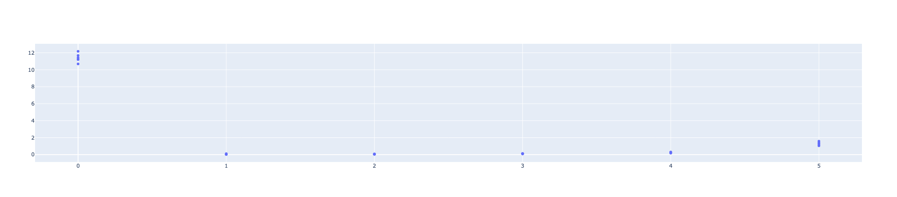
    - blah blah 

  - **0_disorder_spring_mem_cap.png.png**
    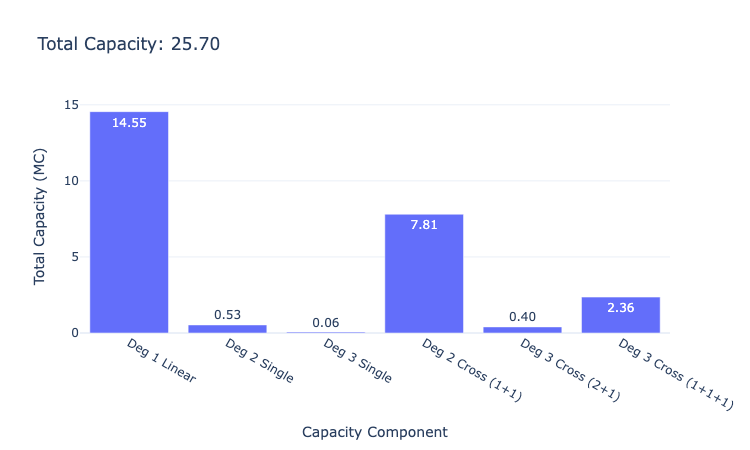
    - blah blah 

  - **0_echo_state_mem_cap.png**
    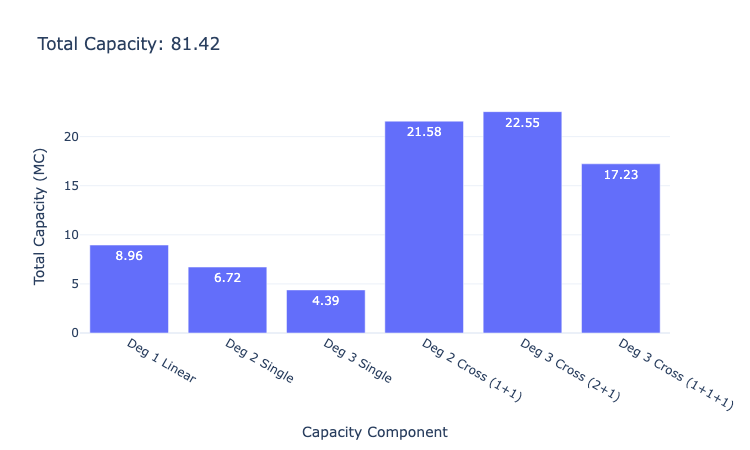
    - blah blah 

  - **0_order_spring_mem_cap.png**
    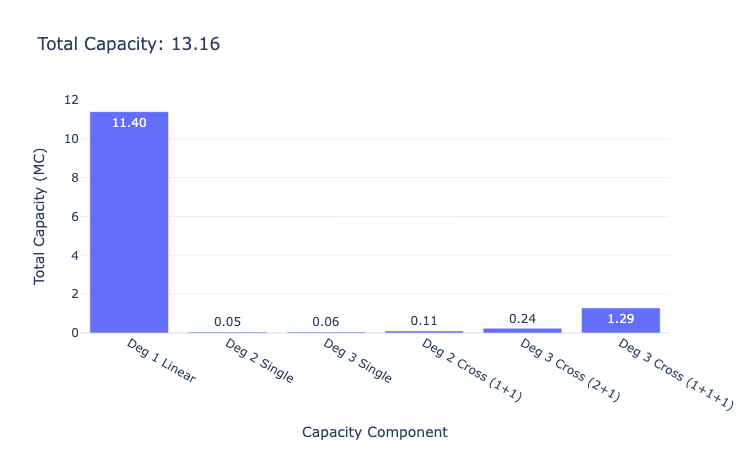
    - blah blah 
## `1_spring_bayesian_mem_cap.ipynb`
- blah blah 
- **Plots:**

  - **1_disordered_spring_1_min_bayesian.png**
    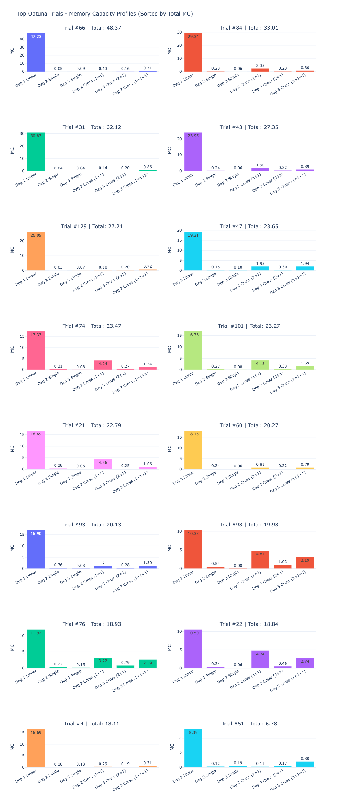
    - blah blah 

  - **1_disordered_spring_1_min_bayesian_just_lin_nonline.png**
    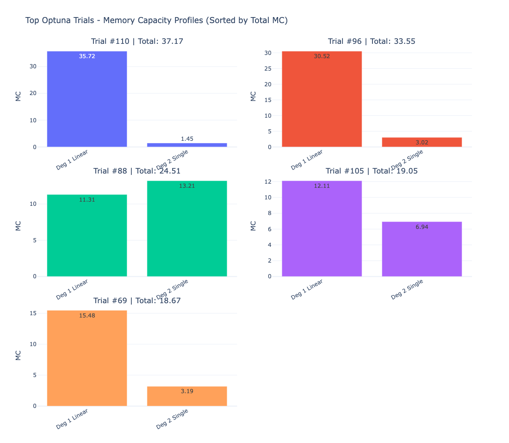
    - blah blah 

  - **1_ordered_spring_1_min_bayesian.png**
    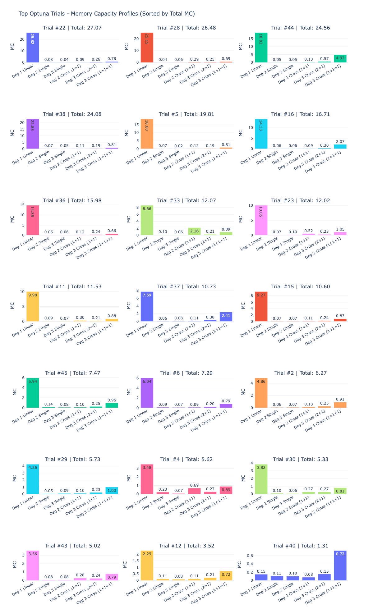
    - blah blah 

  - **1_ordered_spring_1_min_bayesian_just_lin_nonline.png**
    
    - blah blah 
## `4_analayze_both_mem_cap.ipynb`
- blah blah 
- **Plots:**

  - **4_disordered_pareto_front.png**
    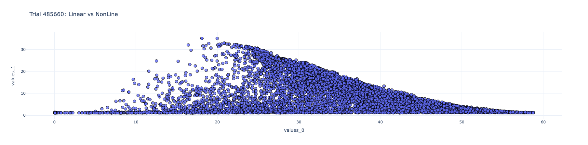
    - blah blah 

  - **4_disordered_spring_top_MC.png**
    
    - blah blah 

  - **4_disordered_spring_top_linear_MC.png.png**
    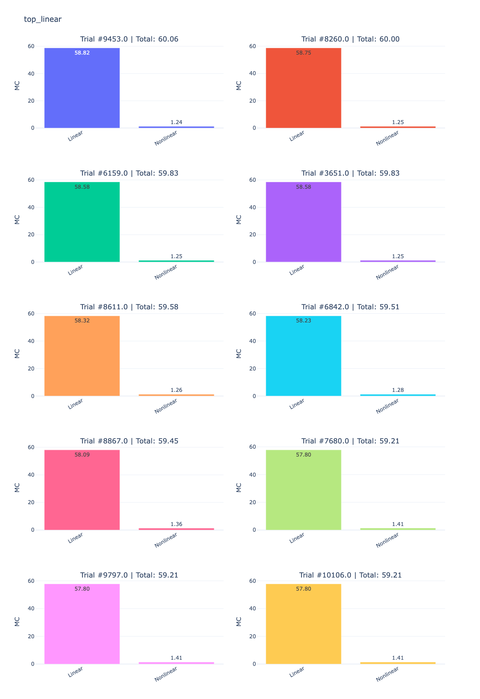
    - blah blah 

  - **4_disordered_spring_top_nonlin_MC.png**
    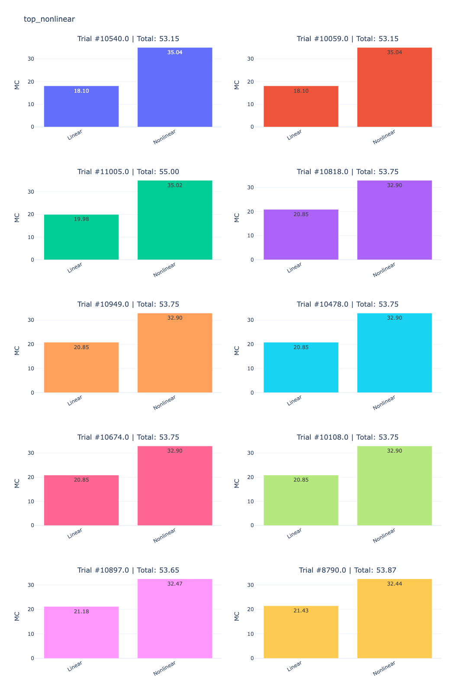
    - blah blah 

  - **4_disordered_top_all_nonlin_mc_details.png**
    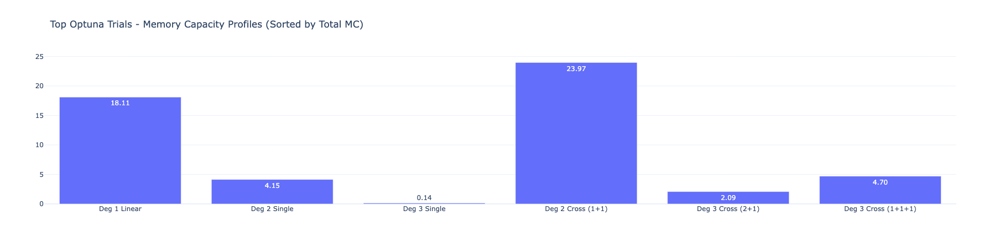
    - blah blah 

  - **4_ordered_pareto_front.png**
    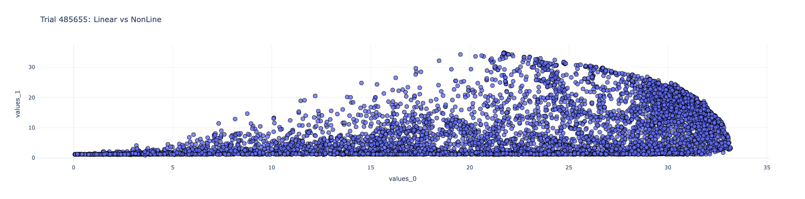
    - blah blah 

  - **4_ordered_spring_top_MC.png**
    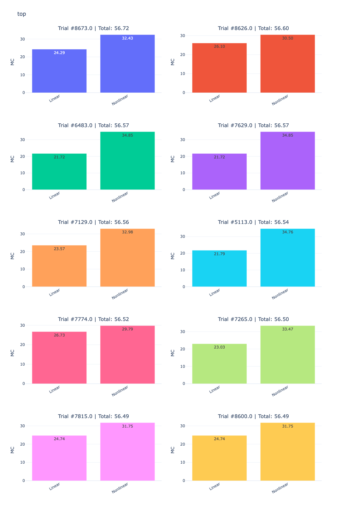
    - blah blah 

  - **4_ordered_spring_top_linear_MC.png.png**
    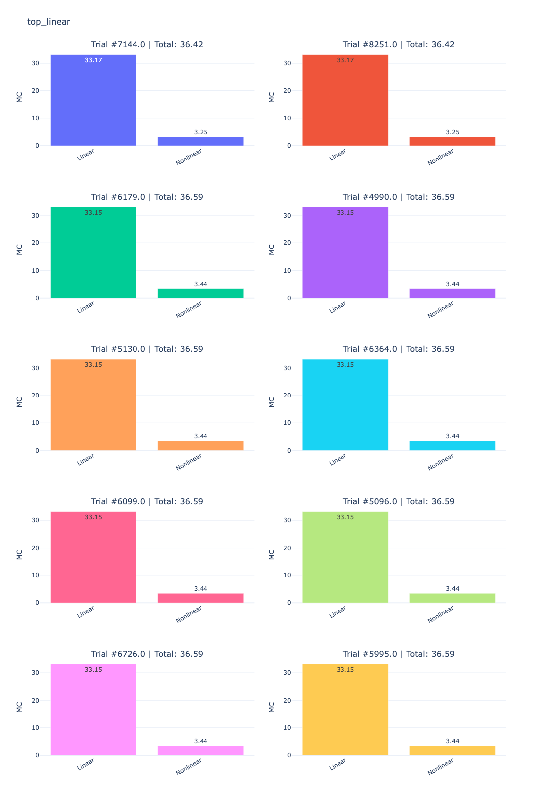
    - blah blah 

  - **4_ordered_spring_top_nonlin_MC.png**
    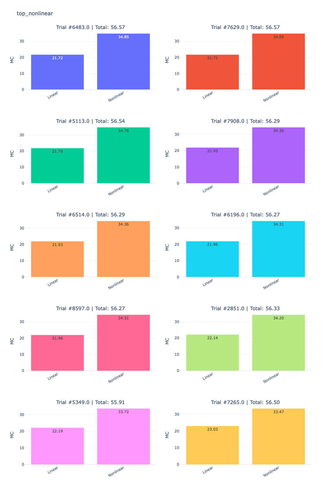
    - blah blah 

  - **4_ordered_top_all_mc_details.png**
    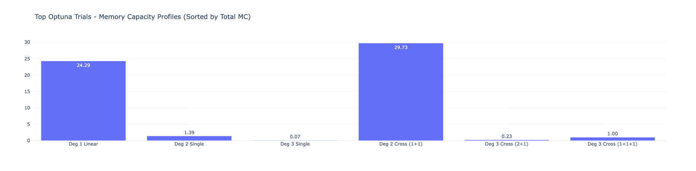
    - blah blah 
## `2_bayesian_mem_cap_order`
- blah blah 
- **Plots:**

## `3_bayesian_mem_cap_disorder`
- blah blah 
- **Plots:**

## `0_simplified_all_mem_cap.ipynb`
- blah blah 
- **Plots:**

## `1_spring_bayesian_mem_cap.ipynb`
- blah blah 
- **Plots:**

## `2_bayesian_mem_cap_order`
- blah blah 
- **Plots:**

## `4_analayze_both_mem_cap.ipynb`
- blah blah 
- **Plots:**